

<picture><source media="(prefers-color-scheme: dark)" srcset="assets/dark/header.svg"/>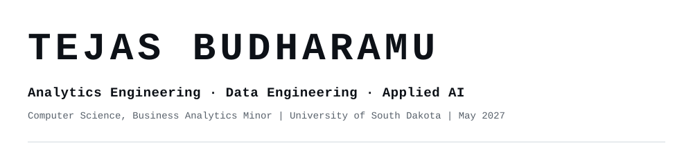</picture>

<a href="https://www.linkedin.com/in/tejas-budharamu-b64984276/"><picture><source media="(prefers-color-scheme: dark)" srcset="assets/dark/b-linkedin.svg"/></picture></a>
<a href="mailto:Tejasbudharamu@outlook.com"><picture><source media="(prefers-color-scheme: dark)" srcset="assets/dark/b-email.svg"/></picture></a>
<a href="resume/Tejas_Budharamu_Resume.pdf"><picture><source media="(prefers-color-scheme: dark)" srcset="assets/dark/b-status.svg"/></picture></a>

<picture><source media="(prefers-color-scheme: dark)" srcset="assets/dark/s01.svg"/></picture>
<picture><source media="(prefers-color-scheme: dark)" srcset="assets/dark/whoami.svg"/>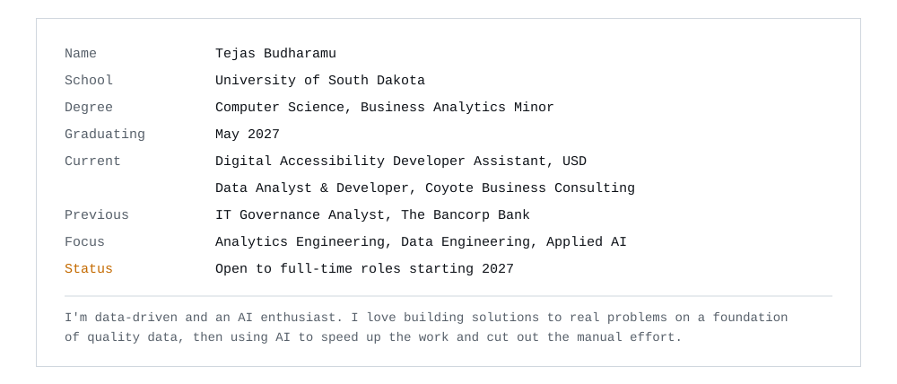</picture>

<picture><source media="(prefers-color-scheme: dark)" srcset="assets/dark/s02.svg"/>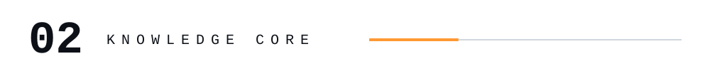</picture>
<picture><source media="(prefers-color-scheme: dark)" srcset="assets/dark/stack.svg"/></picture>

  

<picture><source media="(prefers-color-scheme: dark)" srcset="assets/dark/s03.svg"/></picture>

<picture><source media="(prefers-color-scheme: dark)" srcset="assets/dark/p-infra.svg"/>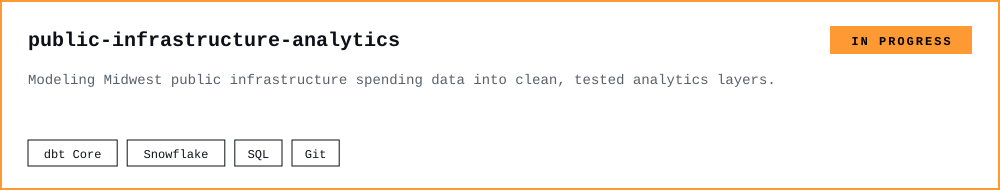</picture>

<picture><source media="(prefers-color-scheme: dark)" srcset="assets/dark/p-sdmts.svg"/></picture>
<a href="https://github.com/Tejas14Feb/spotify-ml-project"><picture><source media="(prefers-color-scheme: dark)" srcset="assets/dark/p-spotify.svg"/>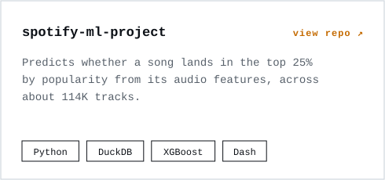</picture></a>

<a href="https://github.com/Tejas14Feb/iot-ecg-anomaly"><picture><source media="(prefers-color-scheme: dark)" srcset="assets/dark/p-ecg.svg"/></picture></a>
<a href="https://github.com/Tejas14Feb/bayesian-cq-analysis"><picture><source media="(prefers-color-scheme: dark)" srcset="assets/dark/p-bayes.svg"/></picture></a>

<picture><source media="(prefers-color-scheme: dark)" srcset="assets/dark/s04.svg"/>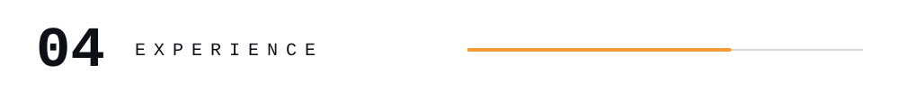</picture>
<picture><source media="(prefers-color-scheme: dark)" srcset="assets/dark/experience.svg"/></picture>

<b>What I did there</b>

 

**Center for Digital Accessibility, USD:** backend services and REST APIs for a cloud accessibility platform, plus AWS (Lambda, Textract, Bedrock) pipelines for document parsing and WCAG validation.

**The Bancorp Bank:** one standard set of KPI/KRI metrics across 14 IT departments, executive dashboards on ServiceNow and Salesforce data, and LLM-based audit bots.

**Coyote Business Consulting, SDMTS:** database design and an Excel to Airtable migration, validation pipelines that cut manual processing by 70%, and leadership dashboards.

**NSF I-Corps:** 50+ interviews with industry leaders turned into GTM analytics, using Python, R, Power BI, and Tableau.

<picture><source media="(prefers-color-scheme: dark)" srcset="assets/dark/s05.svg"/>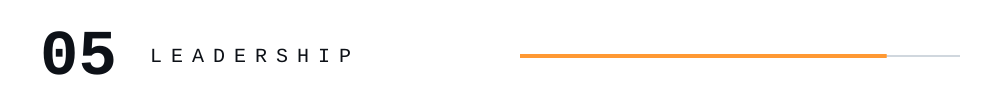</picture>
<picture><source media="(prefers-color-scheme: dark)" srcset="assets/dark/leadership.svg"/></picture>

<picture><source media="(prefers-color-scheme: dark)" srcset="assets/dark/s06.svg"/></picture>
<picture><source media="(prefers-color-scheme: dark)" srcset="assets/dark/awards.svg"/>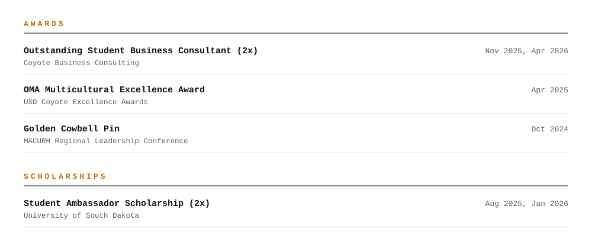</picture>

<picture><source media="(prefers-color-scheme: dark)" srcset="assets/dark/s07.svg"/>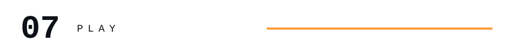</picture>

<!-- TTT:START -->

<picture><source media="(prefers-color-scheme: dark)" srcset="assets/ttt/dark/status.svg?v=1-0-0-0"/></picture>

<a href="https://github.com/Tejas14Feb/Tejas14Feb/issues/new?title=ttt%7Cmove%7C1&body=Press%20%2A%2ASubmit%20new%20issue%2A%2A%20to%20play%20square%201.%20No%20need%20to%20change%20anything."><picture><source media="(prefers-color-scheme: dark)" srcset="assets/ttt/dark/empty-1.svg"/></picture></a><a href="https://github.com/Tejas14Feb/Tejas14Feb/issues/new?title=ttt%7Cmove%7C2&body=Press%20%2A%2ASubmit%20new%20issue%2A%2A%20to%20play%20square%202.%20No%20need%20to%20change%20anything."><picture><source media="(prefers-color-scheme: dark)" srcset="assets/ttt/dark/empty-2.svg"/></picture></a><a href="https://github.com/Tejas14Feb/Tejas14Feb/issues/new?title=ttt%7Cmove%7C3&body=Press%20%2A%2ASubmit%20new%20issue%2A%2A%20to%20play%20square%203.%20No%20need%20to%20change%20anything."><picture><source media="(prefers-color-scheme: dark)" srcset="assets/ttt/dark/empty-3.svg"/>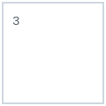</picture></a> 
<a href="https://github.com/Tejas14Feb/Tejas14Feb/issues/new?title=ttt%7Cmove%7C4&body=Press%20%2A%2ASubmit%20new%20issue%2A%2A%20to%20play%20square%204.%20No%20need%20to%20change%20anything."><picture><source media="(prefers-color-scheme: dark)" srcset="assets/ttt/dark/empty-4.svg"/></picture></a><a href="https://github.com/Tejas14Feb/Tejas14Feb/issues/new?title=ttt%7Cmove%7C5&body=Press%20%2A%2ASubmit%20new%20issue%2A%2A%20to%20play%20square%205.%20No%20need%20to%20change%20anything."><picture><source media="(prefers-color-scheme: dark)" srcset="assets/ttt/dark/empty-5.svg"/></picture></a><a href="https://github.com/Tejas14Feb/Tejas14Feb/issues/new?title=ttt%7Cmove%7C6&body=Press%20%2A%2ASubmit%20new%20issue%2A%2A%20to%20play%20square%206.%20No%20need%20to%20change%20anything."><picture><source media="(prefers-color-scheme: dark)" srcset="assets/ttt/dark/empty-6.svg"/></picture></a> 
<a href="https://github.com/Tejas14Feb/Tejas14Feb/issues/new?title=ttt%7Cmove%7C7&body=Press%20%2A%2ASubmit%20new%20issue%2A%2A%20to%20play%20square%207.%20No%20need%20to%20change%20anything."><picture><source media="(prefers-color-scheme: dark)" srcset="assets/ttt/dark/empty-7.svg"/></picture></a><a href="https://github.com/Tejas14Feb/Tejas14Feb/issues/new?title=ttt%7Cmove%7C8&body=Press%20%2A%2ASubmit%20new%20issue%2A%2A%20to%20play%20square%208.%20No%20need%20to%20change%20anything."><picture><source media="(prefers-color-scheme: dark)" srcset="assets/ttt/dark/empty-8.svg"/></picture></a><a href="https://github.com/Tejas14Feb/Tejas14Feb/issues/new?title=ttt%7Cmove%7C9&body=Press%20%2A%2ASubmit%20new%20issue%2A%2A%20to%20play%20square%209.%20No%20need%20to%20change%20anything."><picture><source media="(prefers-color-scheme: dark)" srcset="assets/ttt/dark/empty-9.svg"/></picture></a>

Click a square, then press <b>Submit new issue</b> on the page that opens. A GitHub Action plays your move, the bot answers, and the board updates in about a minute. <a href="https://github.com/Tejas14Feb/Tejas14Feb/issues/new?title=ttt%7Cnew&body=Press%20%2A%2ASubmit%20new%20issue%2A%2A%20to%20start%20a%20new%20game.">Restart</a>

<b>Recent moves</b>

 

| Player | Move | When (UTC) |
|---|---|---|
| nobody yet | | |

<!-- TTT:END -->
