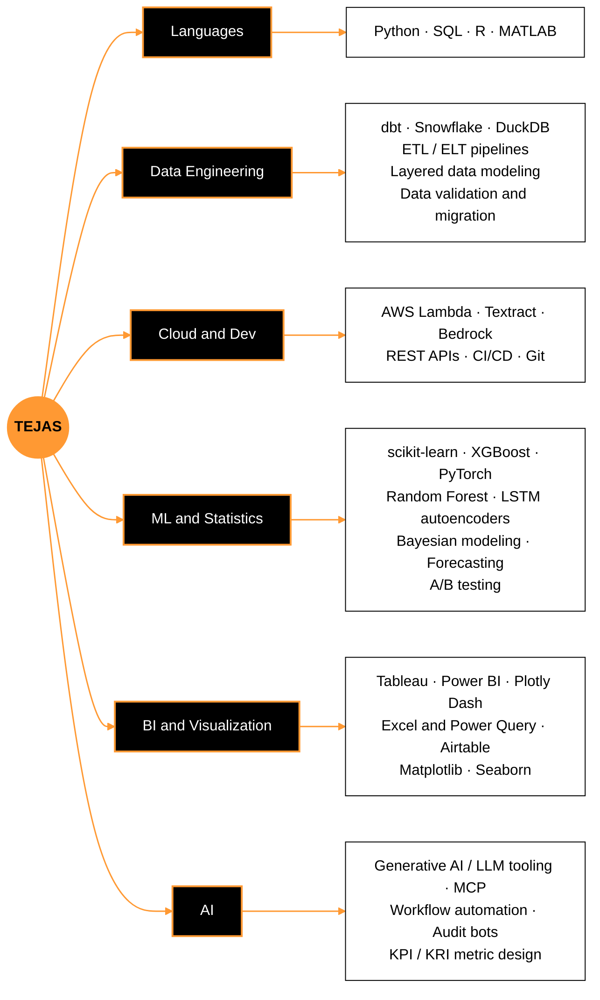

<div align="center">

# Tejas Budharamu

**I turn messy data into metrics people trust.**

Computer Science + Business Analytics @ University of South Dakota &nbsp;|&nbsp; Class of 2027

<a href="https://www.linkedin.com/in/tejas-budharamu-b64984276/"><picture><source media="(prefers-color-scheme: dark)" srcset="https://img.shields.io/badge/LINKEDIN-0d1117?style=flat-square"/></picture></a>
<a href="mailto:Tejasbudharamu@outlook.com"><picture><source media="(prefers-color-scheme: dark)" srcset="https://img.shields.io/badge/EMAIL-0d1117?style=flat-square"/></picture></a>


</div>

<br>

### 01 · whoami

```text
$ whoami
name      tejas budharamu
school    university of south dakota, cs major + business analytics minor (may 2027)
now       digital accessibility developer assistant @ usd center for digital accessibility
before    it governance analyst @ the bancorp bank
focus     analytics engineering · data engineering · applied ai
building  public-infrastructure-analytics (dbt + snowflake)
```

I like the part of data work where a messy spreadsheet becomes a model, a metric, and a decision. I picked a Business Analytics minor next to CS because I want to be an engineer who solves real problems, not just writes code.

<br>

### 02 · stack



<p align="center">
  
</p>

<p align="center">
<picture><source media="(prefers-color-scheme: dark)" srcset="https://img.shields.io/badge/SQL-0d1117?style=flat-square"/></picture>
<picture><source media="(prefers-color-scheme: dark)" srcset="https://img.shields.io/badge/Snowflake-0d1117?style=flat-square&logo=snowflake&logoColor=ffffff"/></picture>
<picture><source media="(prefers-color-scheme: dark)" srcset="https://img.shields.io/badge/dbt-0d1117?style=flat-square&logo=dbt&logoColor=ffffff"/></picture>
<picture><source media="(prefers-color-scheme: dark)" srcset="https://img.shields.io/badge/DuckDB-0d1117?style=flat-square&logo=duckdb&logoColor=ffffff"/></picture>
<picture><source media="(prefers-color-scheme: dark)" srcset="https://img.shields.io/badge/Jupyter-0d1117?style=flat-square&logo=jupyter&logoColor=ffffff"/></picture>
<picture><source media="(prefers-color-scheme: dark)" srcset="https://img.shields.io/badge/Pandas-0d1117?style=flat-square&logo=pandas&logoColor=ffffff"/></picture>
<picture><source media="(prefers-color-scheme: dark)" srcset="https://img.shields.io/badge/XGBoost-0d1117?style=flat-square"/></picture>
<picture><source media="(prefers-color-scheme: dark)" srcset="https://img.shields.io/badge/Tableau-0d1117?style=flat-square"/></picture>
<picture><source media="(prefers-color-scheme: dark)" srcset="https://img.shields.io/badge/Power%20BI-0d1117?style=flat-square"/></picture>
<picture><source media="(prefers-color-scheme: dark)" srcset="https://img.shields.io/badge/Plotly%20Dash-0d1117?style=flat-square&logo=plotly&logoColor=ffffff"/></picture>
<picture><source media="(prefers-color-scheme: dark)" srcset="https://img.shields.io/badge/Airtable-0d1117?style=flat-square&logo=airtable&logoColor=ffffff"/></picture>
<picture><source media="(prefers-color-scheme: dark)" srcset="https://img.shields.io/badge/Excel%20and%20Power%20Query-0d1117?style=flat-square"/></picture>
</p>

<br>

### 03 · projects

<table>
  <tr>
    <td colspan="2">
      <b>public-infrastructure-analytics</b> &nbsp;<br>
      Modeling Midwest public infrastructure spending data into clean, tested analytics layers.<br>
      <code>dbt Core</code> <code>Snowflake</code> <code>SQL</code> <code>Git</code>
    </td>
  </tr>
  <tr>
    <td width="50%" valign="top">
      <b>SDMTS Supply Chain Mapping Tool</b><br>
      Moved a 2,671-record manufacturer database from Excel to Airtable and built the cleaning and validation pipelines behind a supply chain map that runs live on the SDMTS website.<br>
      <code>Airtable</code> <code>ETL</code> <code>Data validation</code>
    </td>
    <td width="50%" valign="top">
      <a href="https://github.com/Tejas14Feb/spotify-ml-project"><b>spotify-ml-project</b></a><br>
      Predicts whether a song lands in the top 25% by popularity from its audio features, across about 114K tracks, with an interactive dashboard.<br>
      <code>Python</code> <code>DuckDB</code> <code>XGBoost</code> <code>Plotly Dash</code>
    </td>
  </tr>
  <tr>
    <td width="50%" valign="top">
      <a href="https://github.com/Tejas14Feb/iot-ecg-anomaly"><b>iot-ecg-anomaly</b></a><br>
      Detects cardiac anomalies in wearable ECG signals (PTB-XL), comparing an LSTM autoencoder against an Isolation Forest baseline and testing on-device latency.<br>
      <code>Python</code> <code>LSTM</code> <code>scikit-learn</code>
    </td>
    <td width="50%" valign="top">
      <a href="https://github.com/Tejas14Feb/bayesian-cq-analysis"><b>bayesian-cq-analysis</b></a><br>
      Bayesian regression of phosphorus concentration against stream discharge, with exact conjugate posteriors and posterior predictive checks.<br>
      <code>Python</code> <code>SciPy</code> <code>Bayesian statistics</code>
    </td>
  </tr>
</table>

<br>

### 04 · experience

| When | Role | Where |
|:--|:--|:--|
| Aug 2026 - Present | **Digital Accessibility Developer Assistant** | Center for Digital Accessibility, USD |
| May 2026 - Aug 2026 | **IT Governance Analyst** | The Bancorp Bank, Sioux Falls SD |
| Aug 2025 - Apr 2026 | **Data Analyst & Developer** | Coyote Business Consulting, SDMTS |
| May 2025 - Jul 2025 | **Entrepreneur Lead, AI/ML Supply Chain Research** | National Science Foundation I-Corps |

<details>
<summary>What I did there</summary>
<br>

**Center for Digital Accessibility:** backend services and REST APIs for a cloud accessibility platform, plus AWS (Lambda, Textract, Bedrock) pipelines for document parsing and WCAG validation.

**The Bancorp Bank:** one standard set of KPI/KRI metrics across 14 IT departments, executive dashboards on ServiceNow and Salesforce data, and LLM-based audit bots.

**Coyote Business Consulting:** database design and Excel to Airtable migration, validation pipelines that cut manual processing by 70%, and leadership dashboards.

**NSF I-Corps:** 50+ interviews with industry leaders turned into GTM analytics, with Python, R, Power BI, and Tableau.

</details>

<br>

### 05 · leadership

| When | Role | Organization |
|:--|:--|:--|
| Aug 2023 - Present | **President** | Indian Student Association, USD |
| Aug 2024 - Present | **Brother** · VP for Alumni Relations (Jan - May 2026) · Internal Control (Jan - May 2025) | Delta Sigma Pi, Alpha Eta Chapter |
| May 2024 - May 2026 | **President** | Residence Hall Association, USD |
| May 2025 - May 2026 | **Coordinator for Presidents & Education** | MACURH |
| Feb 2024 - Sep 2025 | **Finance Committee Chair & Senator** | Student Government Association, USD |
| Aug 2023 - Dec 2025 | **Peer Mentor** | University of South Dakota |
| Aug 2024 - May 2025 | **Finance Director** | International Club, USD |
| May 2024 - Oct 2024 | **VP for Finance** | Dakota Days, USD |

<br>

### 06 · awards

| When | Award |
|:--|:--|
| Apr 2026, Nov 2025 | **Outstanding Student Business Consultant** (2x), Coyote Business Consulting |
| Jan 2026, Aug 2025 | **Student Ambassador Scholarship** (2x), University of South Dakota |
| Apr 2025 | **OMA Multicultural Excellence Award**, USD Coyote Excellence Awards |

<br>

### 07 · contributions

<picture>
  <source media="(prefers-color-scheme: dark)" srcset="https://raw.githubusercontent.com/Tejas14Feb/Tejas14Feb/output/snake-dark.svg"/>
  
</picture>
